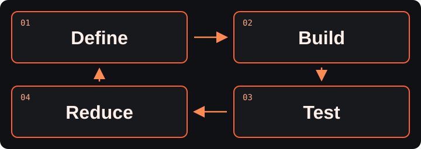

# Builder Lab Workbench

<picture>
  <source media="(prefers-reduced-motion: reduce)" srcset="assets/readme/builder-lab-ascii-still.png">
  
</picture>

[View the static artwork](assets/readme/builder-lab-ascii-still.png)

**Build a reproducible task environment. Find the minimum sufficient intelligence to do the job reliably.**

**[Start here](docs/START_HERE.md)** | **[Copy the model prompt](docs/MODEL_PROMPT.md)** | **[Run the local practice](#run-the-current-baseline)**

Local workflow: [tested](docs/VALIDATION.md). Hosted Coder workspace: [unavailable](docs/HOSTED_READINESS.md).

This is the shared workbench for the Builder Lab at **Durham Food Hall, November 10, 2026, 6–8 pm Eastern (America/New_York)**, and for continuing the work afterward.

[Task-environment contract](docs/TASK_ENVIRONMENT.md) | [First example](challenges/care-fit/README.md) | [Participant guide](docs/PARTICIPANT_GUIDE.md)

We build the **working environment around a small language model** so it can do a particular job reliably. That reproducible task-environment package contains the runner (harness), tools, behavior rules, system prompt, supplied context, permissions, and evaluation. A capability is what that package can do. We improve the surrounding environment, measure its behavior, and determine how little model capacity the task actually needs.

Hosts supply a versioned starting package, synthetic evidence, common input/output contract, deterministic baseline, evaluator, and review process. Participants can improve a tool, prompt, context selection, permission boundary, behavior, or test. Evidence interpretation and failure review are equally useful contributions.



**Define** the task and success criteria. **Build** its environment. **Test** against evidence. **Reduce** complexity while preserving the tested behavior, then repeat.

## First example: care-fit

The [care-fit task environment](task-environments/care-fit/package.json) examines a fictional family's need for daily afterschool care. It distinguishes a potential schedule/service fit from part-week tutoring, drop-in activities, or event enrichment and returns **potential fit**, **mismatch**, or **unknown**, with citations. A potential fit never establishes seats, admission, eligibility, or an outcome.

An Access Lab documentary finding motivates this example; see [evidence and attribution](docs/EVIDENCE.md). All runnable cases are newly authored synthetic examples. They contain no real family records and provide no real referral guidance. Domain review remains required. Care-fit is the first example environment, not the limit of the Lab's purpose.

## Run the current baseline

From the repository root, with Python 3.12 available:

```console
python -m labbench run --split practice
python -m labbench run --split evaluation --output results/local/evaluation.json
```

On systems that call Python `python3`, use that name instead. These commands run the sample environment with its deterministic baseline. They do not test a model, MurMur, or hosted isolation. The baseline uses the standard library; no model, package install, paid API, or hosted workspace is needed. Read the [participant guide](docs/PARTICIPANT_GUIDE.md) for setup and the [adapter contract](docs/ADAPTER_CONTRACT.md) for the current executable interface.

## Join, continue, or hand off

1. Inspect the package, files, and tools you can actually access. Select one bounded environment change or review task.
2. Run or review the shared examples and record the behavior you intend to improve.
3. Change one component, evaluate it, and record successes, failures, and resource observations.
4. Submit package changes and an [experiment result](docs/RESULT_TEMPLATE.md) through the [contribution path](CONTRIBUTING.md). Save a [progress handoff](docs/PROGRESS_TEMPLATE.md) so another session can resume.

Working with an AI assistant? Copy the [model prompt](docs/MODEL_PROMPT.md). It explains the purpose, first task, boundaries, and handoff. Review the assistant's work before sharing it.

## Local and proposed hosted access

The public repository is the link/QR destination: https://github.com/PublikPrinciple/civikstack-lab-workbench. Phones can read the package and support review; coding is intended for laptops.

The proposed hosted path pairs an isolated **Coder browser workspace** with authenticated access to a selected model on the host's desktop through **MurMur**. In that design, attendees would not download model weights. This path is unconfigured and unproven; [hosted readiness](docs/HOSTED_READINESS.md) records the gates. The local baseline and manual review are the available fallback. Terraform can provision infrastructure; it does not define model behavior or establish participant isolation by itself.

Beakon is proposed as the host control center for environment and resource health: what is running, its resource use, connection state, and failures. That integration is not implemented here.

A RoutePack describes the route through inputs, outputs, steps, evidence, and permission references. It does not imply an implemented RPOS adapter or grant authority to execute a step. See the [task-environment contract](docs/TASK_ENVIRONMENT.md).

## Current boundaries

- Only reviewed, trusted local adapters should run in the current harness. Participant packages are untrusted executable code and require isolated execution before a hosted service can run them safely; the local evaluator is not that boundary.
- Keep private records, credentials, weights, and identifying intake material out of contributions. Preserve unknowns and source attribution.
- The model-size policy remains unresolved: the starter production rule is `<=1B`; earlier planning mentioned `7B`. This preparation does not relax the existing rule or approve a model. The deterministic baseline avoids that dependency.
- A repository license has not been selected. Public visibility does not establish unrestricted reuse. Preserve upstream template notices.

See [policy decisions](docs/POLICY_DECISIONS.md), [status](docs/STATUS.md), and [validation](docs/VALIDATION.md). Access Lab frames the research problem; Intelligence Lab develops task environments and evaluates their behavior; Utility Lab examines compute requirements. No real-world service deployment or Mavis, Beakon, or RPOS integration is supplied by these event materials.

[Host run-of-show](docs/meetup.md) · [Maintainer review](docs/REVIEW_CHECKLIST.md) · [Earlier rehearsal cards](challenges/README.md)
