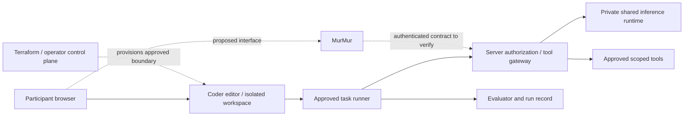

# Builder Lab Workbench: hosted readiness

[Start here](START_HERE.md) · [Task-environment contract](TASK_ENVIRONMENT.md) · [Architecture](ARCHITECTURE.md) · [Validation record](VALIDATION.md) · [Policy decisions](POLICY_DECISIONS.md)

The Lab builds a reproducible **task environment**: task context, system prompt, behaviors, allowed tools, execution harness, permission boundaries and evaluation. The goal is to find the least demanding approach that meets an agreed task standard among the approaches actually tested. A capability is what that environment enables a model to do.

The proposed event experience is a participant signing into an isolated browser coding workspace, editing a task-environment package, and testing it against a shared desktop-hosted model through a MurMur interface. Participants would not download a model for each workspace. **That hosted experience is not configured or verified.** The local deterministic baseline and manual review path are the available fallback. No service, login, credential, network rule or public endpoint is created by this document.

## Components and responsibilities

| Component | Responsibility in the proposed design | Current evidence and limits |
| --- | --- | --- |
| Terraform provisioning | Describe and provision approved workspace infrastructure, images and lifecycle. | A Coder/Docker template exists. Terraform does not define all model behavior or establish isolation by itself. Docker provider 4.6.0 checksum failure still blocks schema validation. |
| Coder browser workspace | Give each participant an editor and persistent project files inside a reviewed execution boundary. | Template scaffold only; no hosted participant login, isolation, persistence or concurrency test is recorded. Dev Container startup is also unverified. |
| Task-environment package | Version the context, prompt, behavior, tool requests, route and evaluation configuration. | The care-fit package is a runnable local sample. A participant-authored package is untrusted input, including any executable adapter code. Its requested permissions are not authorization. |
| Harness/task runner | Load the approved package, supply task input, run its route and capture structured results. | The Python local runner supports the synthetic sample. Its subprocess timeout is not a security sandbox, network restriction or complete resource limit. Run reviewed code locally. |
| Authorization and tool gateway | Authenticate the participant/run; authorize model and tool calls; enforce quotas, timeouts and data boundaries on the server. | Required hosted component, not implemented by these documents. It must reject requests outside the operator policy even when a package or prompt requests them. |
| Inference endpoint and model runtime | Load an approved shared model and execute bounded inference requests on operator-controlled hardware. | No model, endpoint, GPU access, capacity or permission policy is configured or demonstrated. The raw model endpoint must remain private. |
| MurMur interface | Proposed participant-facing interface for reaching the selected shared model and observing a task run. | MurMur's deployment, API, authentication, streaming and tool integration have not been inspected or verified here. Confirm its actual contract before selecting integration work. It cannot substitute for server authorization or execution isolation. |
| Beakon resource management | Proposed view and management of resource inventory, available capacity and environment health. | No Beakon integration or Rust implementation has been found in this repository. Capacity reporting does not authorize access, perform Fabric placement or confer RPOS authority; those contracts and integrations remain separate, unimplemented work. |
| Evaluator | Compare outputs against versioned references, report separate quality/resource measures, and preserve failures for human review. | The local sample evaluator reports correctness, evidence support and unknown preservation. Synthetic results do not establish real-world reliability. Model/GPU resource measurements are not supplied by the local baseline. |

The RoutePack portion of a package describes route inputs, outputs, steps, evidence references and permission references. A runner resolves those references against approved tools and policy. The proposed hosted path still needs an implemented, tested adapter; this document does not establish RPOS or live RoutePack integration. See the [task-environment contract](TASK_ENVIRONMENT.md) for the current package representation.

All arrows describe the target design, not existing connectivity. Operator control-plane credentials and the desktop/LAN are outside participant access.

## Boundary that must be demonstrated

Participant code needs an isolation design appropriate to untrusted submissions. The current template is explicitly a trusted-pilot scaffold, not evidence of a safe public multiuser service. It sets a non-root user, a memory ceiling and `no-new-privileges`, but those settings alone do not prove isolation. Its CPU shares are relative scheduling weights, not a CPU quota. Its `host.docker.internal` host-gateway mapping needs review: the template does not implement an approved destination allowlist or demonstrate blocked desktop/LAN access.

Before hosted use, the operator must select and test the execution boundary, including whether separate VMs or another stronger isolation mechanism is required. Participants must have no Docker socket, privileged container, control-plane token, Terraform state, host home directory or unrestricted host mount. A workspace must not reach another participant's files, services or credentials.

The server must enforce these rules independently of prompts and participant-editable manifests:

- Per-participant identity, explicit model/tool grants, short-lived scoped access and revocation. Never share the desktop administrator credential or a master inference key.
- Deny-by-default network access with reviewed destinations. Allow only required repository access and the authenticated gateway; prohibit raw model endpoint, arbitrary desktop/LAN access and direct control-plane access. Record any justified exceptions.
- Approved tool definitions and argument validation, scoped filesystem paths, and explicit approval for effects outside the task. Treat model-generated calls as requests, not permission grants.
- Per-request input/output limits, bounded tool steps, timeouts, per-user concurrency and request budgets, and a host-wide queue/capacity ceiling. Model and compute budgets are operator policy; the package may request stricter limits.
- Termination of the whole task execution tree, cleanup and protection against a task retaining credentials or continuing background work after cancellation.
- Minimal operational logs: request/run ID, authorized identity, model/tool name, status, timing and measured resource totals. Do not record file contents or prompts by default. Any diagnostic content capture needs an explicit purpose, authorization, access restriction and retention period.

Permission denials remain denials. Support staff must not solve access failures by sharing accounts, exposing the raw endpoint or removing network restrictions.

## Readiness evidence before inviting hosted use

Assign people to these roles; no commitment is implied: **event lead**, **workspace operator**, **inference operator**, **security reviewer**, **Access/domain reviewer**, and **participant support lead**. One person may hold multiple roles when the review is explicit. Record who owns each gate and who can pause the service.

Keep a dated readiness record with version/commit, environment, expected result, actual result and a link to redacted evidence. Every gate below is **pending** until that record exists.

| Gate | Evidence required | Owner |
| --- | --- | --- |
| Provisioning integrity | Resolve the Docker provider 4.6.0 checksum failure without bypassing verification; validate the pinned template and image on the intended host; record reviewed Terraform plan and version/digest provenance. | Workspace operator |
| Workspace lifecycle | A participant-role account signs in, opens the editor, runs the sample, stops/restarts, recovers files and exports its contribution. Record the exact tested image and startup procedure. | Workspace operator |
| Isolation and network | A dedicated test participant cannot read another workspace, reach the desktop/LAN/raw model endpoint, access control-plane state or obtain Docker privileges. Record denied and allowed tests and the chosen isolation design. | Security reviewer |
| MurMur integration | Identify the actual component/version, inspect its available interface and demonstrate authenticated routing, errors, cancellation and correct association of results with a run. | Inference operator |
| Authentication and permissions | Reject missing, expired, revoked and wrong-scope credentials; reject unauthorized models/tools/paths; prove that editing a manifest or prompt cannot grant access. | Security reviewer |
| Shared model | Record approved model ID/version, parameter count, quantization, license, runtime, context limits and hardware; demonstrate one shared service rather than one model copy per workspace. | Inference operator |
| Limits and cancellation | Exercise request/token/tool-step/concurrency limits and cancellation, including child-process cleanup. Show that one participant cannot consume all capacity or continue after revocation. | Workspace and inference operators |
| Concurrency and recovery | Set expected attendee concurrency and acceptance thresholds before testing. Run that load, record latency/errors/queue behavior and measured CPU/GPU/memory, then test service restart and graceful fallback. | Inference operator |
| Task and evaluator | Domain-review the synthetic references and source interpretation; reproduce the same package version locally and hosted; retain per-case failures and separate quality measures. | Access/domain reviewer |
| Data and logs | Inspect actual logs and storage for unintended prompt/file/credential retention; record access, retention, deletion and participant visibility rules. | Security reviewer |
| Support rehearsal | A person using only the participant guide completes onboarding and one submission; rehearse each fallback below, including a phone-only participant. | Participant support lead |
| Policy approval | Resolve model ceiling and repository/contribution licensing decisions, and approve the hosted access scope. | Event lead / repository owner |

The current repository production rule is `<=1B` parameters; prior planning also mentioned `7B`. The conflict remains unresolved. Keep model identity and limits parameterized and make no silent policy change. The no-model baseline is available while the owner decides. See [policy decisions](POLICY_DECISIONS.md).

## Support protocol and event fallback

Before the event, the support lead publishes the tested entry link and approved support contact only after the readiness gates pass. Until then, the public repository link opens instructions, the copyable [model prompt](MODEL_PROMPT.md), sample package and manual workflow. It does not imply that a hosted login exists.

For a support case, capture a run/request ID if available, time, component, brief symptom and whether work is saved. Do not collect passwords, tokens, prompts or family records. Let the relevant operator diagnose restricted logs. Save the participant's progress checkpoint before changing sessions.

| Symptom | Support action | Continue the build |
| --- | --- | --- |
| Sign-in fails or access is denied | Support checks the intended account/grant through the approved process; operator handles correction or revocation. Do not share a working account. | Read the package and annotate one practice case; use a reviewed local baseline if available. |
| Browser workspace fails to start | Operator checks image/provisioning status and recorded startup error; retain files and avoid unreviewed template changes during the session. | Pair with a functioning workspace without sharing credentials, or use the local/manual path. |
| Model request is queued or rate-limited | Show queue/limit status and retry only according to server guidance. Operator checks capacity and fairness; do not increase limits ad hoc. | Review the task route, sources and expected behavior; run the deterministic comparator. |
| Model, desktop or MurMur is unavailable | Inference operator checks the affected component and announces the fallback. Do not expose another endpoint as an emergency shortcut. | Continue with the no-model baseline or manual output; mark inference results as not run. |
| Tool is denied or task exceeds a budget | Preserve the denial/limit result and review the requested route against approved policy. Operator decides whether a later policy change is justified. | Narrow the task or replace the tool-dependent step with a documented manual review. |
| Output looks convincing but fails evaluation | Review each cited excerpt and failed criterion; domain reviewer handles ambiguous reference answers. | Record the failure as a contribution, correct one component, then rerun the same cases. |
| Participant has a phone or no working runtime | Open the [Start Here](START_HERE.md) page and one practice case. Facilitator supplies a printed or saved copy if the connection fails. | Submit labels, citation checks, an unknown case or a route/prompt review with the [result template](RESULT_TEMPLATE.md). A maintainer can transcribe it with attribution. |
| Service must be paused | Assigned operator stops accepting new runs, revokes affected access if needed, preserves minimal diagnostic evidence and communicates the fallback. | Save the [progress checkpoint](PROGRESS_TEMPLATE.md), distinguish completed from unrun work, and continue offline. |

Use the same event deliverable in every path: a versioned task-environment change or review, evidence, observed results, remaining unknowns and the next bounded task. A failed runtime is not a reason to fabricate a result or abandon useful source/prompt/test review.

## Measuring minimum sufficient intelligence

Set task acceptance criteria before comparing approaches. Begin with the rules/no-model baseline, then test only approved model configurations through the same package input/output contract and evaluation set. Record any changes to prompts, tools, route steps, context, model and limits so a result can be reproduced.

Compare quality dimensions separately from resource cost: label/field correctness, evidence support, unknown preservation, failure rate, latency, measured CPU/GPU/memory, and declared model/runtime settings. Repeat nondeterministic runs and preserve failures. Record unmeasured resources as unknown. The current local runner's worker timing does not measure a separate model service or GPU.

The conclusion can be “the smallest tested configuration meeting these stated criteria on this versioned sample.” It cannot establish a universal minimum, performance on real families, or readiness for service deployment. Public synthetic examples and a two-hour event support learning and reproducible next steps; broader claims need additional reviewed evidence.
